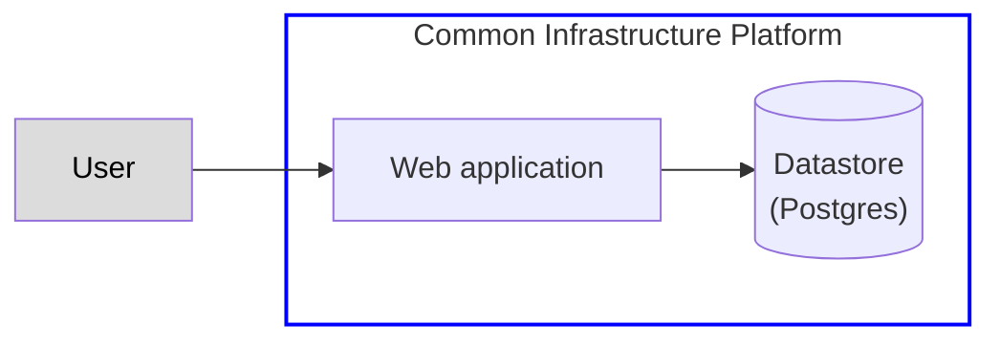

# Basic high-level architecture diagram

These are used for Alpha assessment outputs and to give a basic orientation to the application you're working on.

Don't include anything that isn't part of the service being described.

